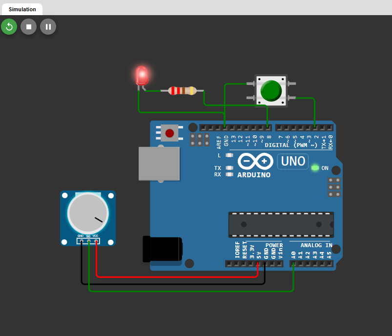

# Звіт з практичної роботи №6

**Тема:** Мікроконтролерний вузол: GPIO, АЦП, таймер, UART

**Варіант:** 4 (Рівень рідини)

### 1. Мета роботи

Налаштувати роботу Arduino Uno з кнопкою, світлодіодом та потенціометром (імітація датчика рівня рідини) і реалізувати періодичну вибірку даних без затримок через `millis()`.

### 2. Схема підключення

* **Кнопка:** підключена між **Pin 2** та **GND** (використовується режим `INPUT_PULLUP`).
* **Світлодіод:** підключений від **Pin 8** через резистор 220 Ом до **GND**.
* **Потенціометр:** виводи **GND** → **GND**, **VCC** → **5V**, сигнальний **SIG** → **A0**.

### 3. Повний код програми

```cpp
const int buttonPin = 2;
const int ledPin = 8;
const int sensorPin = A0;

bool ledState = false;
bool lastButtonState = HIGH;

unsigned long lastMeasurement = 0;
const unsigned long interval = 1000;

void setup() {
  pinMode(buttonPin, INPUT_PULLUP);
  pinMode(ledPin, OUTPUT);
  Serial.begin(9600);
}

void loop() {
  // Миттєве опитування кнопки та зміна стану світлодіода
  bool buttonState = digitalRead(buttonPin);
  if (buttonState == LOW && lastButtonState == HIGH) {
    ledState = !ledState;
    digitalWrite(ledPin, ledState);
  }
  lastButtonState = buttonState;

  // Вимір рівня рідини раз на 1 секунду без зупинки програми
  unsigned long now = millis();
  if (now - lastMeasurement >= interval) {
    lastMeasurement = now;

    int level = map(analogRead(sensorPin), 0, 1023, 0, 100);

    char buffer[20];
    sprintf(buffer, "LVL |%4d|", level);
    Serial.println(buffer);
  }
}
```
### Скрін роботи 


### 4. Приклад виводу у Serial Monitor

```text
LVL |   0|
LVL |  25|
LVL |  74|
LVL | 100|
```

### 5. Висновки

Завдяки `millis()` замість `delay()` програма опитує кнопку тисячі разів на секунду, тому світлодіод вмикається та вимикається миттєво без "зависань". Чітко визначений формат виводу з фіксованою шириною значень зручний тим, що сервер чи інша програма в мережі може легко й без помилок розбирати отримані дані.

## Контрольні запитання

1. **Режим `INPUT_PULLUP`:** Вмикає внутрішній підтягувальний резистор Arduino до 5 В. Це робить так, що при розімкненій кнопці на піні завжди буде стабільний високий рівень (`HIGH`), і вам не потрібно додавати зовнішній резистор на плату.
2. **АЦП Arduino Uno:** Має розрядність 10 біт і повертає значення в діапазоні від **0 до 1023** (де 0 відповідає 0 В, а 1023 - 5 В).
3. **Проблема `delay()`:** Функція повністю блокує процесор. Поки йде затримка, Arduino не може зчитувати кнопки, датчики чи виконувати інший код.
4. **Важливість формату UART:** Програма або сервер на іншому кінці мережі розбирає дані автоматично. Якщо формат чіткий і не змінюється, сервер легко знаходить потрібні числа без помилок.
5. **Синхронний vs асинхронний інтерфейс:**
* **Синхронний (SPI, I2C):** має окремий дріт для передачі тактового сигналу (годинника).
* **Асинхронний (UART):** окремого дроту для годинника немає, а пристрої просто домовляються про однакову швидкість (Baud rate).

## Домашнє завдання

### 1. Пояснення коду та формату

* **Чому `delay()` заважає, а `millis()` працює:**
`delay(1000)` зупиняє програму на цілу секунду. Якби ми залишили його в `loop()`, кнопка працювала б тільки в коротку мить між затримками - якщо натиснути її під час паузи, Arduino просто не помітить цього.
`millis()` нічого не затримує: програма крутиться тисячі разів на секунду, постійно перевіряє кнопку, а вимір сенсора робить тільки тоді, коли минула потрібна секунда.
* **Навіщо потрібні роздільники/формат:**
Людина бачить текст цілісно, а програмі-парсеру потрібні чіткі орієнтири. Роздільник (наприклад `;`) або фіксована ширина колонок дозволяють серверу миттєво витягнути потрібне число з текстового рядка.

### 2. Розрахунки (на папері)

* **Розрахунок АЦП для вхідної напруги 3.3 В (при 5 В):**

$$\text{ADC} = \frac{3.3}{5} \times 1023 = 0.66 \times 1023 = 675.18 \approx \mathbf{675}$$

*Відповідь:* АЦП поверне значення **675**.
* **Розрахунок ШІМ для виходу 3.3 В (при 5 В):**
1. **Шпаруватість у відсотках:**

$$\text{Шпаруватість} = \frac{3.3}{5} \times 100\% = \mathbf{66\%}$$

2. **Значення для `analogWrite()` (діапазон 0–255):**

$$\text{PWM} = \frac{3.3}{5} \times 255 = 0.66 \times 255 = 168.3 \approx \mathbf{168}$$

*Відповідь:* Шпаруватість становить **66%**, значення для `analogWrite()` дорівнює **168**.