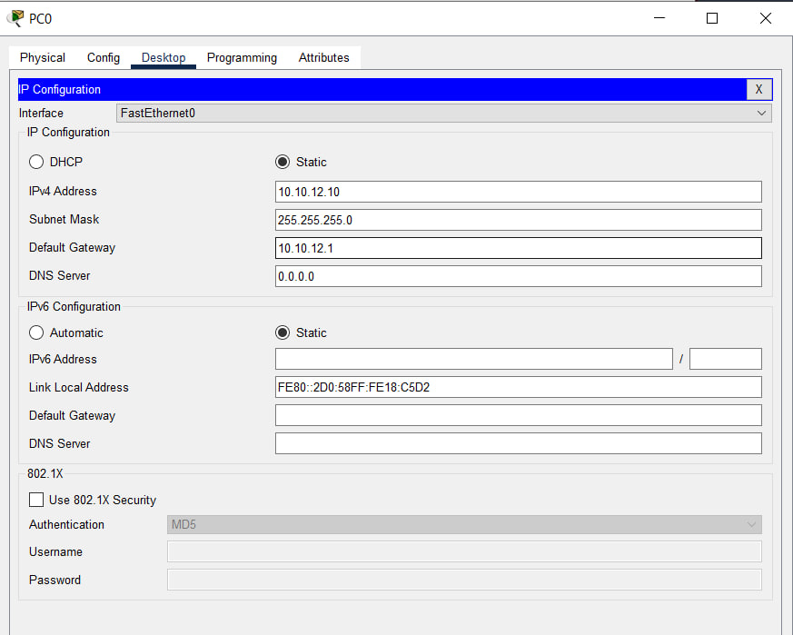
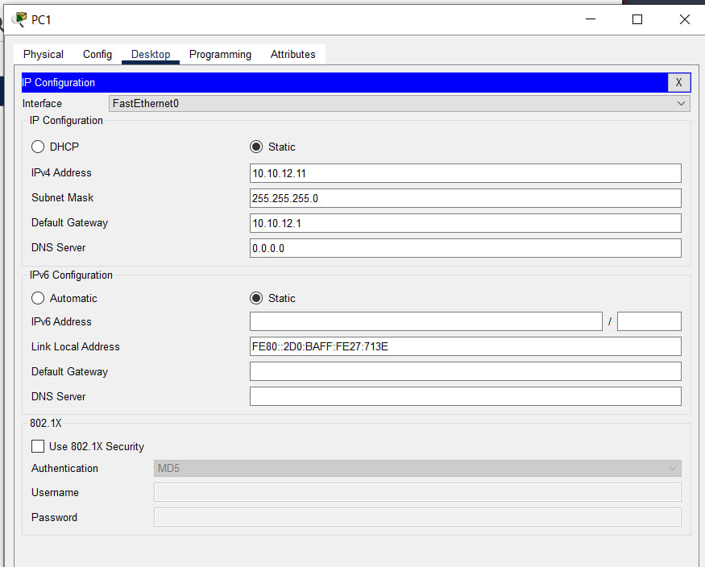
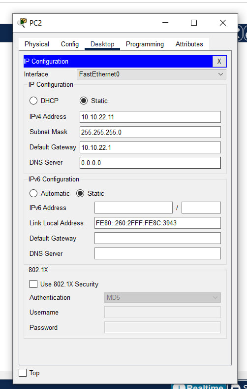
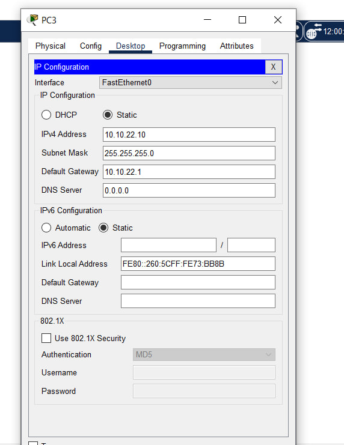
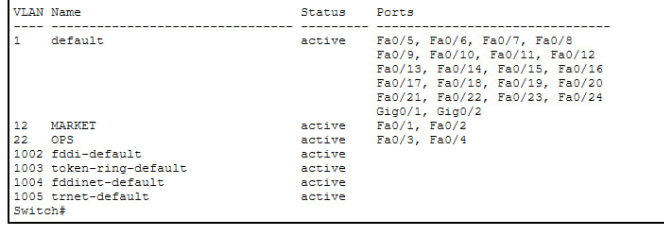
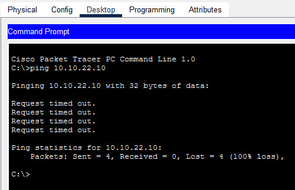
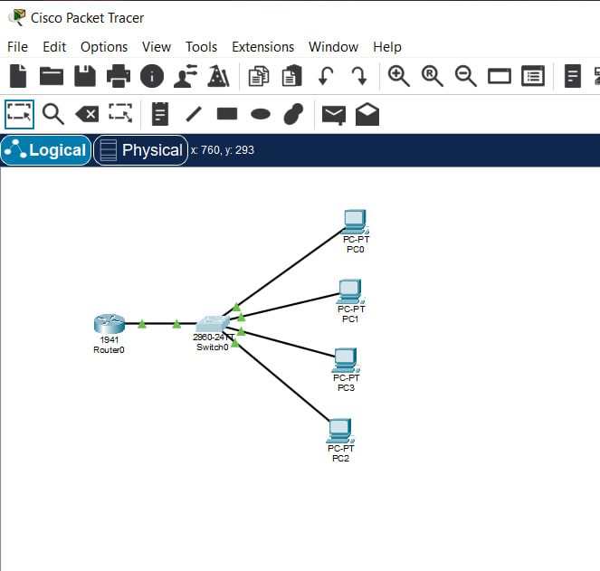

# ЗВІТ з практичної роботи №7

**Тема:** Комутація, VLAN і міжмережева взаємодія

**Варіант:** №4

**Інструмент:** Cisco Packet Tracer

### 1. Мета роботи

Опанувати навички створення та налаштування віртуальних локальних мереж (VLAN) на комутаторі Cisco 2960, перевірити ізоляцію трафіку між ними на L2-рівні та реалізувати міжмережеву маршрутизацію за технологією Router-on-a-Stick за допомогою маршрутизатора Cisco 1941.

---

### 2. Адресації та розподілу портів (Варіант 4)





### 3. Конфігурація обладнання в CLI

#### Налаштування комутатора (Switch0 - Cisco 2960):

```text
Switch> enable
Switch# configure terminal

! Створення VLAN відповідно до Варіанта 4
Switch(config)# vlan 12
Switch(config-vlan)# name MARKET
Switch(config-vlan)# vlan 22
Switch(config-vlan)# name OPS
Switch(config-vlan)# exit

! Призначення портів доступу для VLAN 12
Switch(config)# interface range fa0/1 - 2
Switch(config-if-range)# switchport mode access
Switch(config-if-range)# switchport access vlan 12
Switch(config-if-range)# exit

! Призначення портів доступу для VLAN 22
Switch(config)# interface range fa0/3 - 4
Switch(config-if-range)# switchport mode access
Switch(config-if-range)# switchport access vlan 22
Switch(config-if-range)# exit

! Налаштування транкового порту до роутера
Switch(config)# interface g0/1
Switch(config-if)# switchport mode trunk
Switch(config-if)# exit
```

#### Налаштування маршрутизатора (Router0 - Cisco 1941):

```text
Router> enable
Router# configure terminal

! Включення фізичного інтерфейсу
Router(config)# interface g0/0
Router(config-if)# no shutdown
Router(config-if)# exit

! Налаштування субінтерфейсу для VLAN 12 (MARKET)
Router(config)# interface g0/0.12
Router(config-subif)# encapsulation dot1Q 12
Router(config-subif)# ip address 10.10.12.1 255.255.255.0
Router(config-subif)# exit

! Налаштування субінтерфейсу для VLAN 22 (OPS)
Router(config)# interface g0/0.22
Router(config-subif)# encapsulation dot1Q 22
Router(config-subif)# ip address 10.10.22.1 255.255.255.0
Router(config-subif)# exit
```

### 4. Результати виконання та перевірка

#### Таблиця VLAN (`show vlan brief` на комутаторі):


#### Результати тестування зв'язності (`ping`):

1. **До налаштування Router-on-a-Stick:**
* `PC0 (10.10.12.10)` $\rightarrow$ `PC1 (10.10.12.11)` [цикл в межах VLAN 12]: **Успішно (`Reply from 10.10.12.11`)**.
* `PC0 (10.10.12.10)` $\rightarrow$ `PC3 (10.10.22.10)` [між VLAN 12 та VLAN 22]: **Помилка (`Request timed out`)**.
2. **Після налаштування Router-on-a-Stick:**
* `PC0 (10.10.12.10)` $\rightarrow$ `PC3 (10.10.22.10)`: **Успішно (`Reply from 10.10.22.10`)**.

### 5. Висновки

Створення окремих VLAN розділило комутатор на два повністю ізольовані широкомовні домени (VLAN 12 та VLAN 22). На канальному (L2) рівні комутатор блокує передачу кадрів між різними VLAN. Зв'язність між ПК з різних підмереж з'явилася лише після створення транкового каналу та налаштування субінтерфейсів на маршрутизаторі (Router-on-a-Stick), оскільки передача пакетів між різними IP-мережами вимагає маршрутизації на мережевому (L3) рівні.

### Скріни виконаної робити


### Контрольні запитання

1. **Як комутатор наповнює таблицю MAC-адрес і що робить з кадром невідомого призначення?**
Комутатор автоматично зчитує MAC-адресу відправника (`Source MAC`) з кожного вхідного кадру і записує її в таблицю поруч із номером порту. Якщо призначення кадру невідоме (`Unknown Unicast`), комутатор розсилає його на всі порти поточного VLAN, крім того, з якого кадр прийшов (`Flooding`).
2. **Чому широкомовний кадр однієї VLAN не потрапляє в іншу VLAN на тому самому комутаторі?**
VLAN є окремим віртуальним широкомовним доменом. Комутатор програмно обмежує розповсюдження кадру тільки тими портами, які приписані до тієї ж VLAN ID.
3. **Чим порт доступу відрізняється від транкового за призначенням і форматом кадру?**
* **Access-порт:** підключає кінцеві пристрої (ПК), належить лише одній VLAN і передає звичайні ефірнет-кадри без тегів.
* **Trunk-порт:** з'єднує мережеві пристрої (комутатор-роутер), передає трафік багатьох VLAN, додаючи до кадру 4-байтний тег IEEE 802.1Q.
4. **Що таке тег IEEE 802.1Q і навіщо він потрібен на транку?**
Це спеціальний заголовок у кадрі, який містить номер `VLAN ID`. Він потрібен для того, щоб пристрій на іншому кінці транкового каналу точно знав, до якої саме VLAN належить отриманий пакет.
5. **Порівняйте router-on-a-stick і SVI як способи міжVLAN маршрутизації.**
* **Router-on-a-stick:** маршрутизує трафік через один фізичний кабель на зовнішній роутер за допомогою віртуальних субінтерфейсів (`g0/0.12`, `g0/0.22`).
* **SVI (Switch Virtual Interface):** виконує маршрутизацію всередині L3-комутатора на апаратному рівні, що працює значно швидше й не створює "вузьких місць" у каналі.
6. **Чому до налаштування маршрутизації вузли різних VLAN не обмінювалися пакетами?**
Тому що пристрої перебували в різних L3-підмережах (`10.10.12.0/24` та `10.10.22.0/24`), а звичайний L2-комутатор не має функцій маршрутизації й ізолює трафік різних VLAN.

### Домашнє завдання (Осмислення результату)

* **Розсилання широкомовного кадру проти звичайного:**
Широкомовний кадр (`FF:FF:FF:FF:FF:FF`) призначений для всіх вузлів мережі, тому комутатор дублює його на всі активні порти поточного широкомовного домену. Для звичайного кадру комутатор шукає MAC-адресу отримувача у своїй таблиці `MAC Address Table` і відправляє кадр точково лише на той порт, за яким ця адреса закріплена.
* **Причина ізоляції ARP-запитів між VLAN та вирішення:**
ARP-запит є широкомовним пакетом. Оскільки VLAN створює окремий широкомовний домен, ARP-запит з VLAN 12 відкидається комутатором і не потрапляє на порти VLAN 22. Щоб трафік між ними проходив, до топології додають L3-маршрутизатор (або L3-комутатор), а на ПК вказують IP-адресу відповідного субінтерфейсу роутера як основний шлюз.