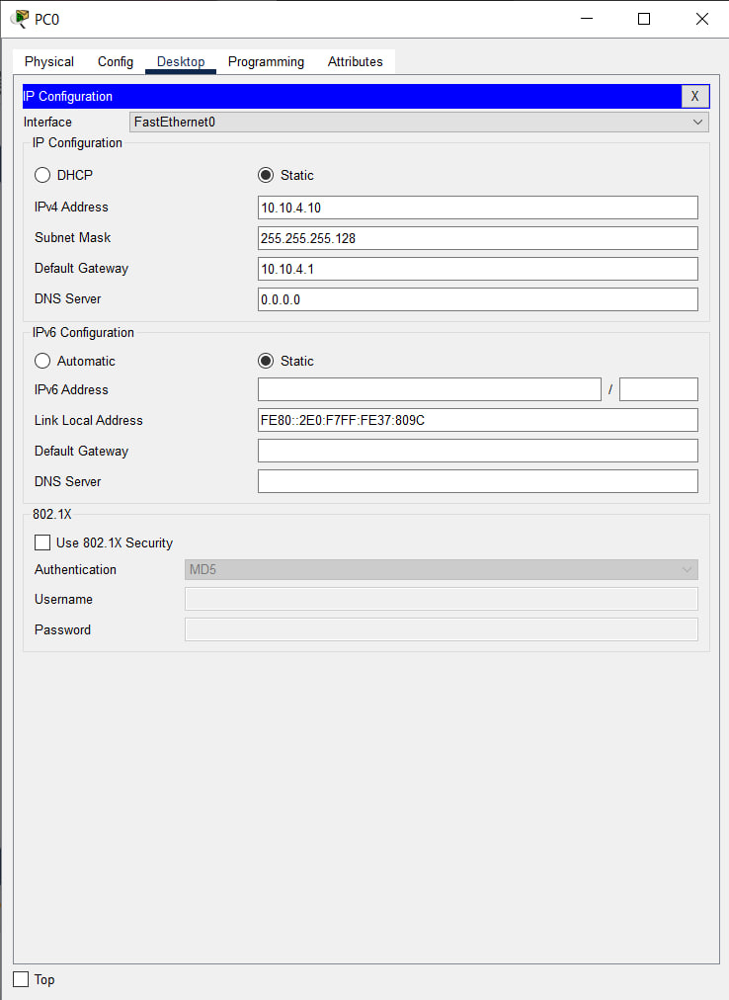
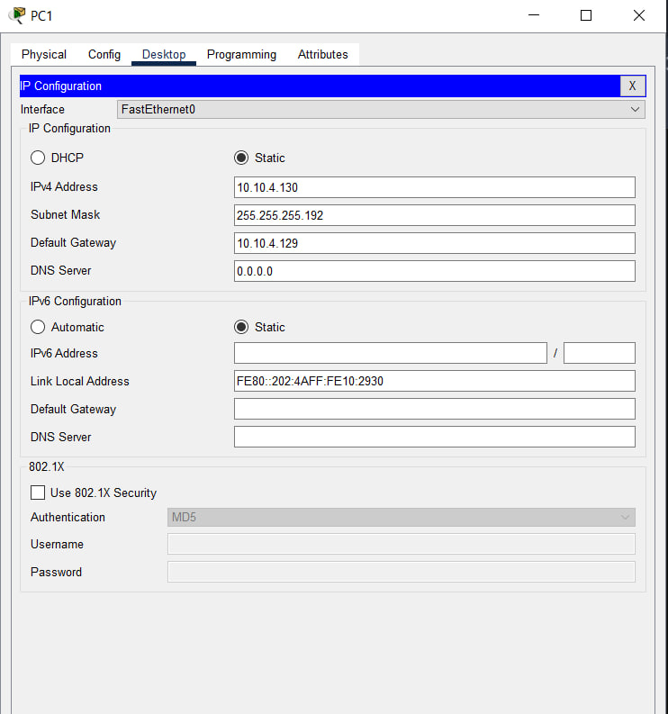
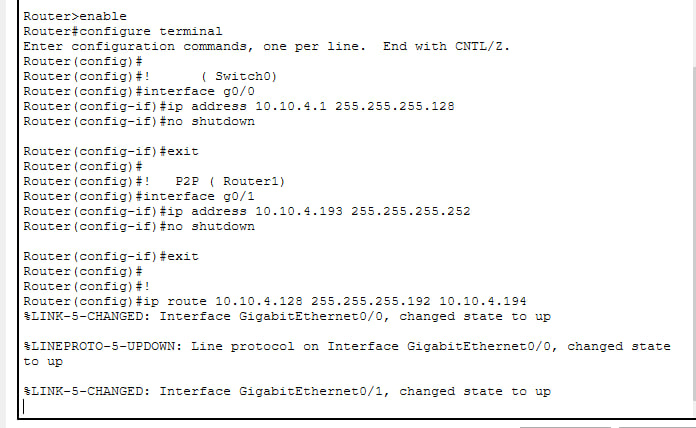
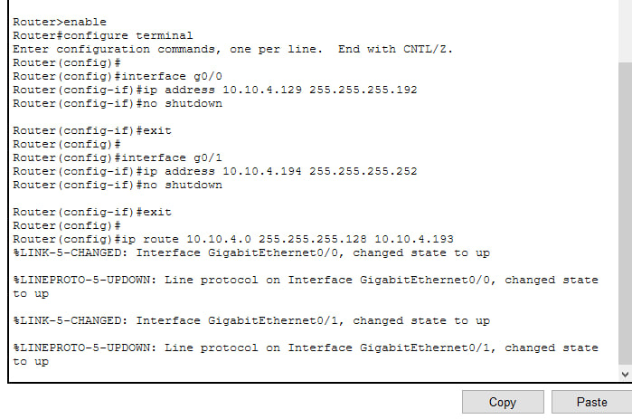
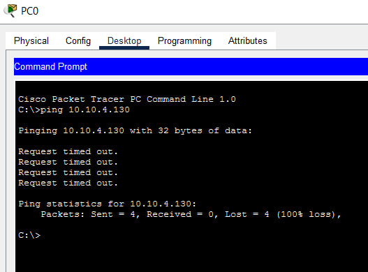
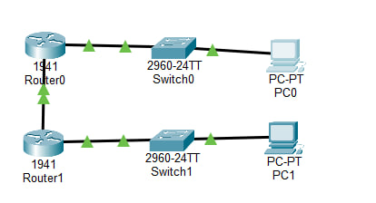

# ЗВІТ з практичної роботи №8 з дисципліни «Комп’ютерні та мікропроцесорні системи»

**Тема:** IPv4-адресація, маски, підмережі та VLSM

**Варіант:** №4

**Базова мережа:** `10.10.4.0/24`

**Вимоги до підмереж:** Підмережа А - 120 вузлів, Підмережа Б - 55 вузлів, P2P - 2 вузли

**Інструмент:** Cisco Packet Tracer

### 1. Мета роботи

Опанувати обчислення IP-адрес, навчитися ділити мережу на рівні частини та за допомогою методу VLSM під конкретні потреби, а також перевірити працездатність схеми в Cisco Packet Tracer.

### 2. Крок 1. Параметри базової мережі

* **Адреса мережі:** `10.10.4.0`
* **Маска:** `255.255.255.0` (`/24`)
* **Широкомовна адреса:** `10.10.4.255`
* **Діапазон придатних адрес:** `10.10.4.1` - `10.10.4.254`
* **Загальна кількість адрес:** 256 (придатних для пристроїв - 254)

### 3. Крок 2. Поділ на 2 підмережі одинакового розміру

Для поділу базової мережі `/24` навпіл запозичується 1 біт. Нова маска - **/25** (`255.255.255.128`). Кожна підмережа отримує по 128 адрес.

1. **Підмережа 1:**
* **Адреса мережі:** `10.10.4.0/25` (Маска: `255.255.255.128`)
* **Діапазон адрес:** `10.10.4.1` - `10.10.4.126`
* **Широкомовна адреса:** `10.10.4.127`

2. **Підмережа 2:**
* **Адреса мережі:** `10.10.4.128/25` (Маска: `255.255.255.128`)
* **Діапазон адрес:** `10.10.4.129` - `10.10.4.254`
* **Широкомовна адреса:** `10.10.4.255`

### 4. Крок 3. Поділ методом VLSM (Таблиця Варіанта 4)

Розрахунок ведеться від наибольшої потреби до найменшої: **А (120) $\rightarrow$ Б (55) $\rightarrow$ P2P (2)**.

| Підмережа | Потреба (вузлів) | Префікс | Адреса мережі | Маска | Діапазон придатних адрес | Широкомовна адреса |
| --- | --- | --- | --- | --- | --- | --- |
| **А** | 120 | `/25` | `10.10.4.0` | `255.255.255.128` | `10.10.4.1` – `10.10.4.126` | `10.10.4.127` |
| **Б** | 55 | `/26` | `10.10.4.128` | `255.255.255.192` | `10.10.4.129` – `10.10.4.190` | `10.10.4.191` |
| **P2P** | 2 | `/30` | `10.10.4.192` | `255.255.255.252` | `10.10.4.193` – `10.10.4.194` | `10.10.4.195` |

* **Використано:** 196 адрес із 256.
* **Вільний резервний блок:** `10.10.4.196` - `10.10.4.255` (60 адрес для майбутнього розширення).

### 5. Таблиця адресації пристроїв у Packet Tracer

| Пристрій | Інтерфейс | IP-адреса | Маска підмережі | Основний шлюз |
| --- | --- | --- | --- | --- |
| **Router0** | `g0/0` (Шлюз А) | `10.10.4.1` | `255.255.255.128` | - |
| **Router0** | `g0/1` (P2P) | `10.10.4.193` | `255.255.255.252` | - |
| **Router1** | `g0/0` (Шлюз Б) | `10.10.4.129` | `255.255.255.192` | - |
| **Router1** | `g0/1` (P2P) | `10.10.4.194` | `255.255.255.252` | - |
| **PC0** | `Fa0` (Сегмент А) | `10.10.4.10` | `255.255.255.128` | `10.10.4.1` |
| **PC1** | `Fa0` (Сегмент Б) | `10.10.4.130` | `255.255.255.192` | `10.10.4.129` |

### 6. Скрипти конфігурації обладнання

#### Команди для Router0 (Верхній роутер):

```text
enable
configure terminal

interface g0/0
ip address 10.10.4.1 255.255.255.128
no shutdown
exit

interface g0/1
ip address 10.10.4.193 255.255.255.252
no shutdown
exit

ip route 10.10.4.128 255.255.255.192 10.10.4.194
```

#### Команди для Router1 (Нижній роутер):
```text
enable
configure terminal

interface g0/0
ip address 10.10.4.129 255.255.255.192
no shutdown
exit

interface g0/1
ip address 10.10.4.194 255.255.255.252
no shutdown
exit

ip route 10.10.4.0 255.255.255.128 10.10.4.193
```

### 7. Результати перевірки (Ping)

При перевірці зв'язку з комп'ютера **PC0** на комп'ютер **PC1** за допомогою команди:
`ping 10.10.4.130`
Отримано успішний результат: `Reply from 10.10.4.130: bytes=32 time<1ms TTL=126`. Зв'язок між підмережами А та Б через канал P2P налаштовано правильно.

### 8. Висновки

Використання методу VLSM дозволило гнучко та економно виділити IP-адреси під різну кількість комп’ютерів у підмережах (120, 55 та 2 вузли) без марнування IP-простору. Завдяки налаштуванню статичних маршрутів між роутерами досягнуто повної міжмережевої зв’язності.

### СКРІНИ ВИКОНАНОЇ РОБОТИ 







### Відповіді на контрольні запитання

1. **Чому для визначення адреси мережі застосовують побітову операцію «І» (AND)?**
Операція `AND` обнуляє частину адреси, яка відповідає за конкретний комп'ютер, залишаючи недоторканою частину мережі. Це дозволяє роутеру точно знати номер всієї мережі.
2. **Що станеться з кількістю адрес, якщо перейти від маски /24 до /25?**
Кількість доступних для пристроїв адрес зменшиться вдвічі - замість 254 залишиться 126.
3. **У чому різниця між рівним поділом та VLSM?**
При рівному поділі всі підмережі отримують однакову маску і однаковий розмір. У VLSM кожна підмережа отримує свою маску, підлаштовану під її реальні потреби.
4. **Чому підмережі у VLSM виділяють від найбільшої до найменшої?**
Великим підмережам потрібні великі блоки адрес, які мають бути вирівняні по межах свого розміру. Якщо почати з дрібних, між блоками з'являться порожні нерозподілені діри.
5. **Навіщо для P2P обирають маску /30?**
Маска `/30` дає усього 2 придатні адреси - саме стільки, скільки потрібно для з'єднання двох роутерів між собою.

### Домашнє завдання 

* **Чому важливо починати розрахунок VLSM з найбільшої підмережі:**
Адреса кожної підмережі у VLSM має бути кратною її розміру ($2^h$). Якщо у Варіанті 4 спочатку виділити 4 адреси для P2P (`.0`-`.3`), то наступна адреса `.4` не зможе стати початком підмережі А на 120 вузлів (якій потрібен блок розміром 128 адрес). Найближче число, кратне 128 - це 128. У результаті адреси з `.4` по `.127` будуть змарновані.
* **Запас невикористаних адрес для підмережі А (120 вузлів):**
Для 120 вузлів виділено блок `/25` на 128 адрес (з них для пристроїв доступні 126). Запас складає: $126 - 120 = 6$ адрес. Це нормальний і найкращий результат для VLSM, оскільки блоки завжди беруться як ступінь двійки ($2^7 = 128$), а менший блок `/26` (на 64 адреси) 120 вузлів фізично вмістити не зможе.