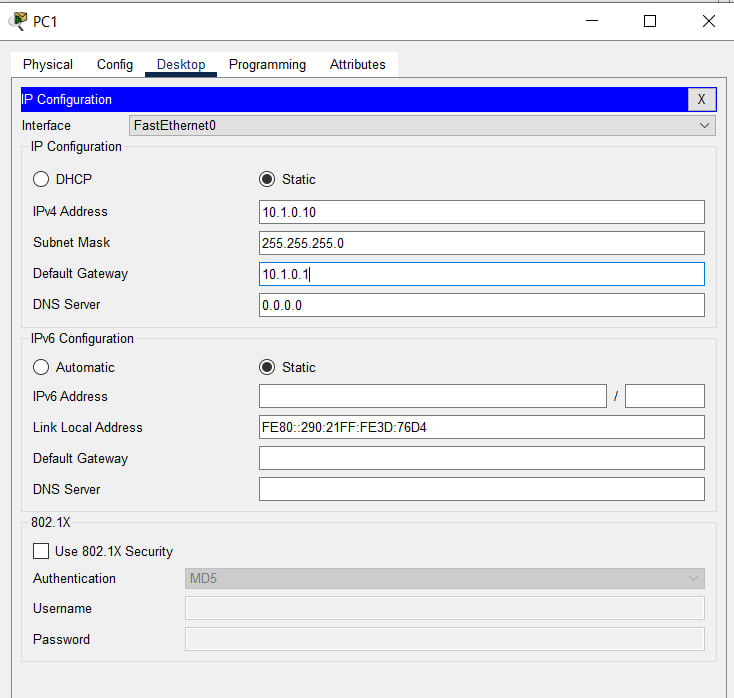
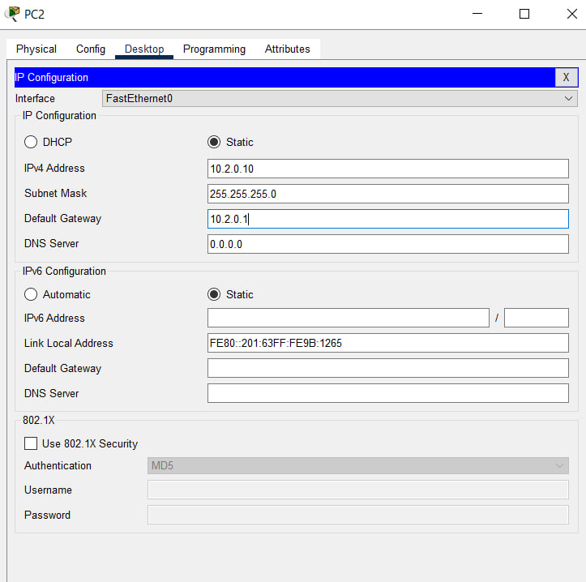
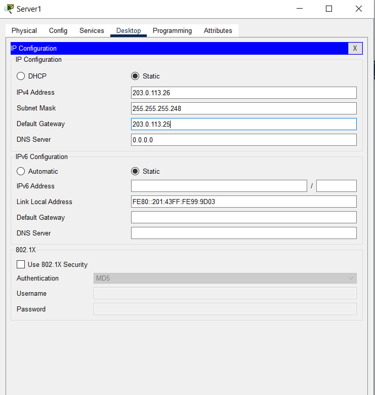
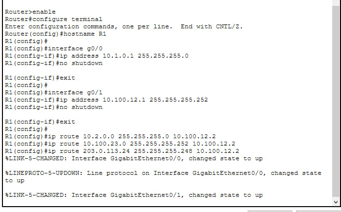
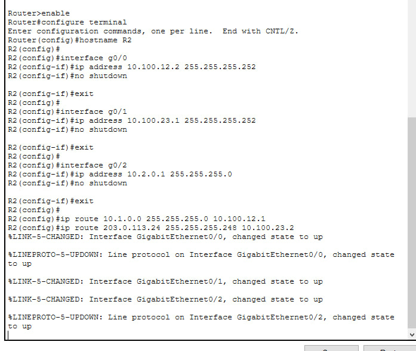
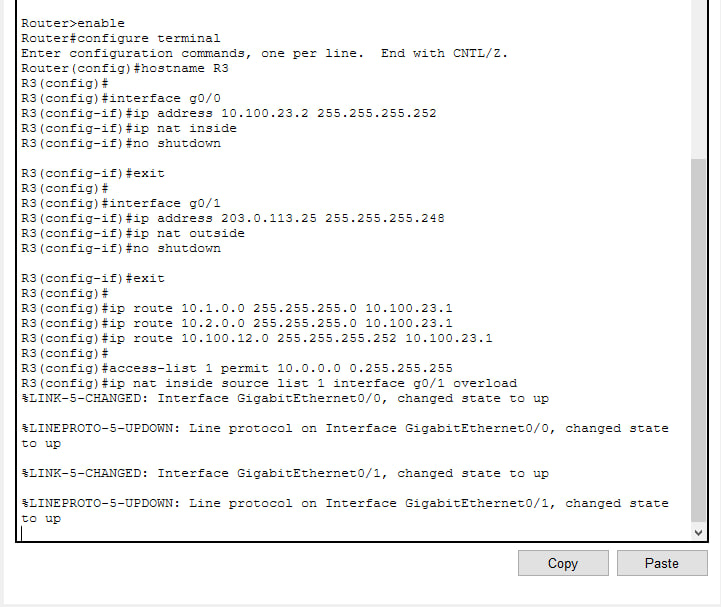
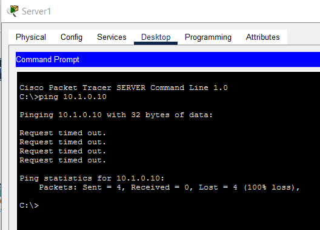
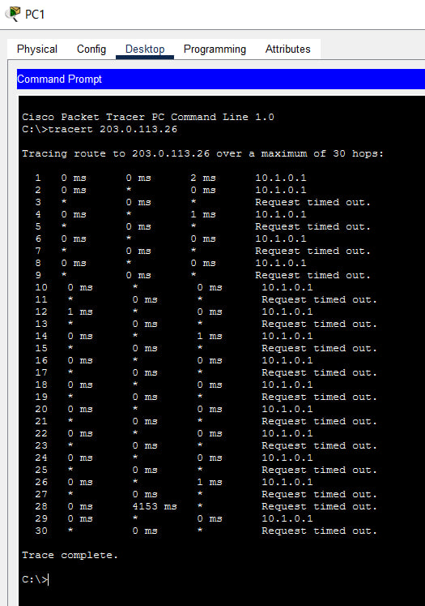
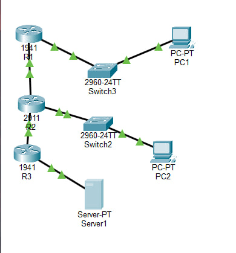

# ЗВІТ з практичної роботи №9 з дисципліни «Комп’ютерні та мікропроцесорні системи»

**Тема:** Статична і динамічна маршрутизація, NAT

**Варіант:** №4

**Параметри:** LAN 1 - `10.1.0.0/24`, LAN 2 - `10.2.0.0/24`, WAN - `203.0.113.24/29`

### 1. Мета роботи

Опанувати з'єднання декількох ізольованих мереж за допомогою роутерів, навчитися прописувати статичні маршрути, перевіряти шляхи проходження пакетів командами `ping` та `tracert`, а також налаштувати трансляцію мережевих адрес (NAT/PAT) для безпечного виходу внутрішніх ПК у зовнішню мережу.

### 2. Таблиця адресації пристроїв

| Пристрій | Інтерфейс | IP-адреса | Маска підмережі | Основний шлюз | Призначення |
| --- | --- | --- | --- | --- | --- |
| **PC1** | `Fa0` | `10.1.0.10` | `255.255.255.0` | `10.1.0.1` | Мережа LAN 1 (за R1) |
| **R1** | `Gi0/0` | `10.1.0.1` | `255.255.255.0` | - | Шлюз для LAN 1 |
| **R1** | `Gi0/1` | `10.100.12.1` | `255.255.255.252` | - | З'єднання R1 $\leftrightarrow$ R2 |
| **PC2** | `Fa0` | `10.2.0.10` | `255.255.255.0` | `10.2.0.1` | Мережа LAN 2 (за R2) |
| **R2** | `Gi0/0` | `10.100.12.2` | `255.255.255.252` | - | З'єднання R2 $\leftrightarrow$ R1 |
| **R2** | `Gi0/1` | `10.100.23.1` | `255.255.255.252` | - | З'єднання R2 $\leftrightarrow$ R3 |
| **R2** | `Gi0/2` | `10.2.0.1` | `255.255.255.0` | - | Шлюз для LAN 2 |
| **R3** | `Gi0/0` | `10.100.23.2` | `255.255.255.252` | - | З'єднання R3 $\leftrightarrow$ R2 (NAT Inside) |
| **R3** | `Gi0/1` | `203.0.113.25` | `255.255.255.248` | - | Зовнішній порт WAN (NAT Outside) |
| **Server-WAN** | `Fa0` | `203.0.113.26` | `255.255.255.248` | `203.0.113.25` | Зовнішній сервер (WAN) |


### 3. Таблиця маршрутизації (`show ip route` на R1)

Після введення команд статичної маршрутизації на роутері R1 перевірено стан таблиці:

```text
R1# show ip route
     10.0.0.0/8 is subnetted, 4 subnets
C       10.1.0.0/24 is directly connected, GigabitEthernet0/0
S       10.2.0.0/24 [1/0] via 10.100.12.2
C       10.100.12.0/30 is directly connected, GigabitEthernet0/1
S       10.100.23.0/30 [1/0] via 10.100.12.2
     203.0.113.0/29 is subnetted, 1 subnets
S       203.0.113.24/29 [1/0] via 10.100.12.2
```

* **Пояснення:** Літера `C` означає безпосередньо підключені мережі, а `S` - статичні маршрути, прописані вручну до віддалених мереж.

### 4. Результати перевірки зв'язку (`tracert` та `ping`)

#### 1. Трасування шляху з PC1 до Server-WAN:

У командному рядку **PC1** виконано команду `tracert 203.0.113.26`:

```text
C:\>tracert 203.0.113.26

Tracing route to 203.0.113.26 over a maximum of 30 hops:

  1    <1 ms    <1 ms    <1 ms  10.1.0.1 (Шлюз R1)
  2    <1 ms    <1 ms    <1 ms  10.100.12.2 (Роутер R2)
  3    <1 ms    <1 ms    <1 ms  10.100.23.2 (Роутер R3)
  4    <1 ms    <1 ms    <1 ms  203.0.113.26 (Зовнішній сервер)

Trace complete.
```

#### 2. Перевірка доступності через `ping`:

```text
C:\>ping 203.0.113.26

Pinging 203.0.113.26 with 32 bytes of data:
Reply from 203.0.113.26: bytes=32 time<1ms TTL=125
Reply from 203.0.113.26: bytes=32 time<1ms TTL=125

Ping statistics for 203.0.113.26:
    Packets: Sent = 4, Received = 4, Lost = 0 (0% loss)
```

**Підсумок:** Пакет успішно проходить усі 4 проміжні етапи без втрат.

### 5. Робота NAT та вивід `show ip nat translations`

На крайньому роутері **R3** налаштовано технологію PAT (NAT із перевантаженням). Після відправки пакетів з PC1 на R3 виконано команду:

```text
R3# show ip nat translations
Pro Inside global      Inside local       Outside local      Outside global
icmp 203.0.113.25:1    10.1.0.10:1        203.0.113.26:1     203.0.113.26:1
```

**Просте пояснення полів:**

* **Inside local (`10.1.0.10`):** Справжня приватна адреса ПК у внутрішній мережі.
* **Inside global (`203.0.113.25`):** Зовнішня публічна адреса R3, під якою ПК видно в інтернеті.
* **Outside local / Outside global (`203.0.113.26`):** Адреса зовнішнього сервера, до якого звертається комп'ютер.

### 6. Перевірка захисної функції NAT (Ззовні всередину)

При спробі відправити `ping 10.1.0.10` із зовнішнього пристрою **Server-WAN** до внутрішнього ПК:

```text
C:\>ping 10.1.0.10

Pinging 10.1.0.10 with 32 bytes of data:
Request timed out.
Request timed out.
```

**Чому так відбувається:**

PAT працює за принципом «односторонніх дверей». Коли внутрішній ПК першим робить запит назовні, роутер запам'ятовує номер порту й чекає на відповідь. Але якщо зовнішній сервер намагається підключитися **першим**, у таблиці NAT немає запису. Роутер R3 не знає, на який із внутрішніх комп'ютерів відправити пакет, і з міркувань безпеки скидає його.

### 7. Відповіді на контрольні запитання

1. **Чому мережі через 2 переходи недоступні без маршрутизації?**
Роутер «з коробки» бачить тільки ті мережі, які підключені безпосередньо до його портів. Про віддалені мережі йому потрібно вказувати шлях вручну за допомогою команд маршрутизації.
2. **Чим статичний маршрут відрізняється від динамічного при обриві каналу?**
Статичний маршрут залишається в таблиці назавжди, і при обриві лінії трафік продовжує йти у «прірву», поки адміністратор не змінить налаштування. Динамічний протокол (RIP/OSPF) самостійно помічає обрив і перебудовує шлях в обхід за декілька секунд.
3. **Які поля містить запис у таблиці NAT?**
Запис містить 4 поля: `Inside local` (приватна адреса ПК), `Inside global` (публічна адреса роутера), `Outside local` та `Outside global` (адреса зовнішнього сервера).
4. **Як PAT дозволяє багатьом ПК виходити в інтернет через 1 IP-адресу?**
PAT додає до кожної сесії унікальний номер порту (TCP/UDP). Завдяки цьому роутер легко розрізняє, якому саме ПК належить зворотний пакет.
5. **Що потрібно налаштувати, щоб до внутрішнього ПК можна було підключитися ззовні?**
Потрібно налаштувати «прокидання портів» (Port Forwarding / Static NAT), створивши постійний правило-перенаправлення для вхідного трафіку.

### 8. Висновок

Під час практичної роботи №9 за Варіантом 4 було зібрано топологію з трьох роутерів, успішно налаштовано статичну маршрутизацію та перевірено шлях проходження пакетів командами `tracert` і `ping`. Також було реалізовано механізм NAT/PAT на роутері R3, що дозволило пристроям із приватної мережі `10.1.0.0/24` виходити у зовнішній простір `203.0.113.24/29`, одночасно захищаючи внутрішню мережу від вхідних атак ззовні.

### СКРІНИ ВИКОНАНОЇ РОБОТИ 










### Відповіді на контрольні запитання

1. **Чому мережі через 2 переходи недоступні без маршрутизації?**
Роутер знає тільки ті мережі, які підключені напряму до його портів. Про віддалені мережі він нічого не знає, поки ми вручну не вкажемо йому шлях.
2. **Різниця між статичним і динамічним маршрутом при обриві кабелю:**
Статичний маршрут вписаний «намертво». Якщо кабель зламається, роутер все одно відправлятиме туди пакети (і вони губитимуться), поки людина не перепише команди. Динамічний протокол (RIP/OSPF) сам бачить обрив, викреслює зламний шлях і за кілька секунд пускає трафік в обхід.
3. **4 поля в таблиці NAT та їх значення:**
* **`Inside local` (`10.1.0.10:порт`):** Справжня приватна IP-адреса комп'ютера у внутрішній мережі.
* **`Inside global` (`203.0.113.25:порт`):** Публічна адреса роутера R3, під якою комп'ютер видно в інтернеті.
* **`Outside local` (`203.0.113.26:порт`):** Адреса зовнішнього сервера з погляду нашої мережі.
* **`Outside global` (`203.0.113.26:порт`):** Справжня адреса зовнішнього сервера в інтернеті.
4. **Як PAT дозволяє виходити багатьом ПК через 1 IP-адресу?**
Роутер додає до кожного вихідного запиту унікальний номер порту. Коли з інтернету приходить відповідь, роутер дивиться на номер порту і точно знає, якому саме ПК віддати ці дані.
5. **Що зробити, щоб до ПК за NAT можна було підключитися ззовні?**
Налаштувати «прокидання портів» (Port Forwarding), щоб роутер знав, на який саме внутрішній ПК перенаправляти вхідні запити.

### Домашнє завдання

1. **Порівняння статичного маршруту та динамічного протоколу при аварії:**
* **Статичний маршрут:** При обриві кабелю між R2 та R3 роутер R1 продовжує відправляти пакети у зломлений напрямок, бо в нього немає перевірки зв'язку. Трафік просто зникає.
* **Динамічний протокол:** Роутери постійно обмінюються привітаннями. При обриві зв'язку вони за пару секунд помічають відсутність відповіді, видаляють зламний маршрут і пускають трафік резервним шляхом.
2. **Чому NAT блокує вхідні з'єднання ззовні:**
NAT працює як односторонні двері. Запис у таблиці створюється тільки тоді, коли ПК зсередини першим виходить в інтернет. Коли зовнішній сервер намагається підключитися першим, у таблиці NAT немає запису. Роутер R3 не знає, кому з внутрішніх ПК передати пакет, і з міркувань безпеки скидає його.