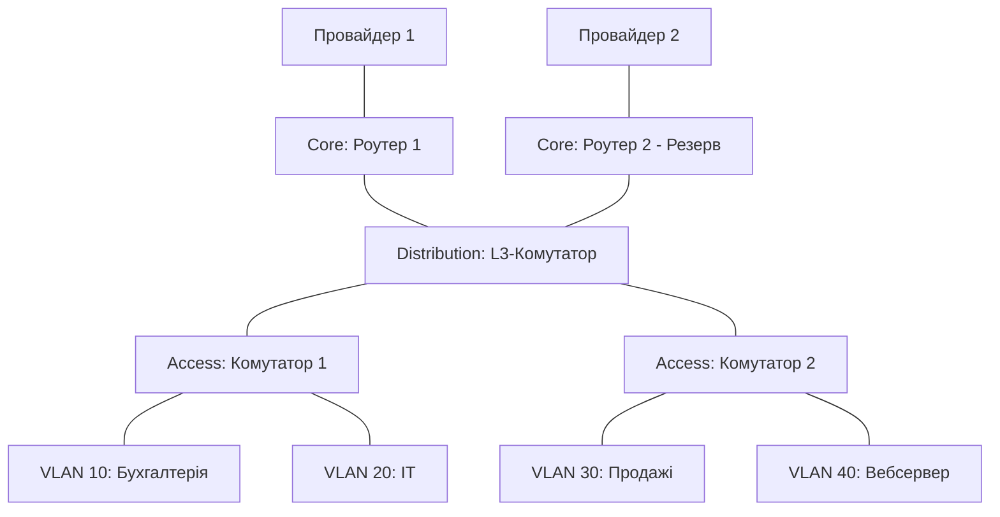

### Контрольні запитання

1. **Етапи проєктування мережі:**
* **Аналіз вимог:** збір інформації (скільки пристроїв, яка потрібна швидкість і безпека).
* **Логічне проєктування:** розробка схеми, розподіл IP-адрес, поділ на VLAN.
* **Фізичне проєктування:** вибір обладнання (роутери, комутатори) та планування кабельних трас.
* **Впровадження та тестування:** монтаж, налаштування та перевірка роботи.
2. **Три рівні ієрархічної моделі:**
* **Core (Ядро):** «швидкісний хайвей», який максимально швидко ганяє трафік між великими сегментами мережі.
* **Distribution (Розподіл):** «перехрестя з світлофорами», де діють правила безпеки, маршрутизація між VLAN та фільтрація трафіку.
* **Access (Доступ):** «розетка у стіні», до якої підключаються кінцеві пристрої (ПК, принтери, Wi-Fi точки).
3. **Bridge vs Host режим у контейнерах:**
* **Bridge:** створює для контейнера окрему віртуальну мережу (з власною IP-адресою та ізоляцією).
* **Host:** забирає ізоляцію - контейнер використовує мережеву картку й IP-адресу самого сервера напряму.
4. **Що таке VPC та з чого складається:**
* **VPC (Virtual Private Cloud):** ваша ізольована приватна мережа всередині публічної хмари (AWS, Google Cloud тощо).
* **Елементи:** подмережі (Subnets), таблиці маршрутизації (Route Tables), мережеві шлюзи (Internet/NAT Gateways) та фаєрволи (Security Groups).
5. **SNMP vs NetFlow у моніторингу:**
* **SNMP:** показує *стан заліза* (завантаження процесора, пам'яті, температуру, чи підключений дріт до порту).
* **NetFlow:** показує *хто і куди гонить трафік* (хто саме забив увесь інтернет-канал).
6. **Чому документація прискорює усунення збоїв:**
Бо інженер одразу бачить готову схему підключень, номери портів та IP-адреси, а не витрачає години на пошуки того, куди веде конкретний кабель у серверній шафі.
7. **Чому в Bridge є звернення за іменем, а в Host - ні:**
У режимі `Bridge` працює вбудований DNS-сервер контейнерної платформи, який знає імена всіх контейнерів. У режимі `Host` контейнер висить на мережі сервера і власного DNS для контейнерів не має.
8. **Чому `0.0.0.0/0` - це порушення безпеки для внутрішнього сервісу:**
Запис `0.0.0.0/0` відкриває доступ будь-кому з усього інтернету. Внутрішній сервіс (наприклад, база даних) повинен приймати запити тільки від свого API, а не від зовнішнього світу.
9. **Порядок перевірки недоступності сервісу:**
1. **Статус і мережа (L1–L4):** чи працює контейнер/сервер і чи проходить `ping` / відгукується порт.
2. **Сервіс і DNS (L7):** чи правильно резолвиться ім'я та чи відповідає веб-сервер.
3. **Логи та ресурси:** вивчення помилок у логах додатка та перевірка, чи не закінчилася оперативка/диск.
*Послідовність така, бо перевірити порт займає 2 секунди, а копатися в логах - набагато довше.*

### Домашнє завдання

#### 1. Логічна схема малої мережі офісу

**Структура мережі:**

* **Основна мережа (VLSM):** `192.168.1.0/24`
* **VLAN 10 (Бухгалтерія, до 30 ПК):** `192.168.1.0/27` (Маска `255.255.255.224`)
* **VLAN 20 (IT-відділ, до 30 ПК):** `192.168.1.32/27` (Маска `255.255.255.224`)
* **VLAN 30 (Продажі, до 60 ПК):** `192.168.1.64/26` (Маска `255.255.255.192`)
* **VLAN 40 (Сервери / Вебсервер):** `192.168.1.128/28` (Маска `255.255.255.240`)

**Розподіл за рівнем ієрархії:**

* **Core Level:** 2 роутери з налаштованим плаваючим маршрутом/VRRP (для резервування двох провайдерів ISP1 та ISP2).
* **Distribution Level:** L3-комутатор, який робить маршрутизацію між VLAN та фільтрує трафік.
* **Access Level:** L2-комутатори, у які вткнуті робочі ПК користувачів та вебсервер.

#### 2. Порівняльна таблиця режимів мереж контейнерів

| Режим мережі | Рівень ізоляції | Швидкість роботи | Типовий випадок використання |
| --- | --- | --- | --- |
| **Bridge** | **Високий** (власна приватна мережа) | Хороша (є невеликі затримки через NAT) | Запуск кількох сервісів на одному сервері (Docker Compose). |
| **Host** | **Низький / Відсутній** (спільна мережа з хостом) | **Максимальна** (без віртуальних мережевих шарів) | Високонавантажені додатки, де важлива кожна мілісекунда. |
| **Overlay** | **Високий** (зашифрована мережа поверх кількох серверів) | Помірна (додаткові витрати на тунелювання) | Кластери з багатьох серверів (Docker Swarm, Kubernetes). |