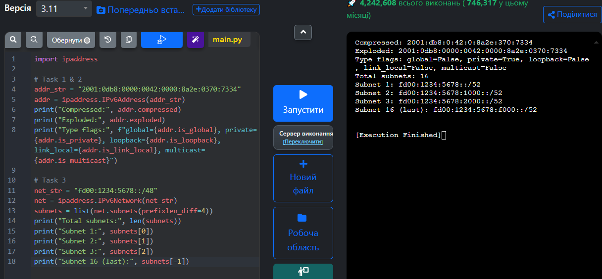

# Звіт із самостійної роботи №11

**Тема:** IPv6: адресація і механізми переходу  
**Варіант:** №4  
**Адреса варіанта:** `2001:0db8:0000:0042:0000:8a2e:0370:7334`  
**Префікс варіанта:** `fd00:1234:5678::/48`

## 1. Скорочення IPv6-адреси

**Початкова адреса:** `2001:0db8:0000:0042:0000:8a2e:0370:7334`

**Кроки скорочення:**
1. **Видалення провідних нулів у кожному блоці:**
   * `0db8` $\rightarrow$ `db8`
   * `0000` $\rightarrow$ `0`
   * `0042` $\rightarrow$ `42`
   * `0000` $\rightarrow$ `0`
   * `0370` $\rightarrow$ `370`
   * Результат кроку: `2001:db8:0:42:0:8a2e:370:7334`
2. **Перевірка на символ `::`:**
   * У даній адресі є лише поодинокі нульові блоки, розділені іншими числами (блок 3 і блок 5). Оскільки тут немає послідовності з двох або більше сусідніх нульових блоків, символ `::` використовувати **не можна**.

**Найкоротший вигляд адреси:** `2001:db8:0:42:0:8a2e:370:7334`

## 2. Визначення типу адреси

* **Тип адреси:** **Global Unicast Address (GUA)** (Глобальна індивідуальна адреса; конкретно - префікс для документації та прикладів RFC 3849).
* **Обґрунтування за бітовим префіксом:**
  Адреса починається з `2001:0db8...`. Перший блок `2001` у двійковій системі має вигляд `0010 0000 0000 0001`. Перші три біти - `001`, що відповідає бітовому шаблону `2000::/3` (діапазон `2000::` - `3fff::`), який виділено під глобальні маршрутизовані адреси інтернету.

## 3. Поділ префікса на 16 підмереж

**Виданий префікс:** `fd00:1234:5678::/48`

**Розрахунок:**
* Щоб отримати 16 підмереж ($16 = 2^4$), додаємо 4 біти до маски: $48 + 4 = \mathbf{52}$.
* Нова маска підмереж: **/52**.
* 13-й шістнадцятковий символ змінюється від `0` до `F`.

**Список підмереж:**
* **Підмережа 1 (перша):** `fd00:1234:5678:0000::/52` (або `fd00:1234:5678::/52`)
* **Підмережа 2:** `fd00:1234:5678:1000::/52`
* **Підмережа 3:** `fd00:1234:5678:2000::/52`
* **Підмережа 16 (остання):** `fd00:1234:5678:f000::/52`

## 4. Визначення власної IPv6-адреси

**Результат виконання команди (`ipconfig` / `ip -6 addr`):**
```text
Ethernet adapter Wi-Fi:
   Link-local IPv6 Address . . . . . : fe80::8c3f:2a11:5e8b:941a%12
   IPv6 Address  . . . . . . . . . . : 2a02:a03f:6534:100:8c3f:2a11:5e8b:941a
```
### Для перевірки правильності обчислень (скорочення адреси, визначення її типу та нарізки 16 підмереж) було виконано програмну перевірку за допомогою стандартного модуля ipaddress у Python
```python
import ipaddress

# Task 1 & 2
addr_str = "2001:0db8:0000:0042:0000:8a2e:0370:7334"
addr = ipaddress.IPv6Address(addr_str)
print("Compressed:", addr.compressed)
print("Exploded:", addr.exploded)
print("Type flags:", f"global={addr.is_global}, private={addr.is_private}, loopback={addr.is_loopback}, link_local={addr.is_link_local}, multicast={addr.is_multicast}")

# Task 3
net_str = "fd00:1234:5678::/48"
net = ipaddress.IPv6Network(net_str)
subnets = list(net.subnets(prefixlen_diff=4))
print("Total subnets:", len(subnets))
print("Subnet 1:", subnets[0])
print("Subnet 2:", subnets[1])
print("Subnet 3:", subnets[2])
print("Subnet 16 (last):", subnets[-1])
```


**Аналіз виявленої адреси:**

* **Адреса:** `fe80::8c3f:2a11:5e8b:941a`
* **Тип:** **Link-Local** (локальна для зв'язку в межах одного сегмента мережі, починається з `fe80::/10`).
* **Механізм отримання:** Згенерована автоматично операційною системою при підключенні мережевого адаптера (автоконфігурація без участі роутера).
* **Глобальна адреса:** `2a02:a03f:6534:100:...` отримана автоматично через роутер за допомогою механізму **SLAAC** (Router Advertisement).

## Додаткове завдання: Порівняння заголовків IPv4 та IPv6

| Параметр | IPv4 | IPv6 |
| --- | --- | --- |
| **Розмір заголовка** | Змінний (від 20 до 60 байтів) | Фіксований (чітко 40 байтів) |
| **Поле часу життя** | `TTL` (Time to Live) | `Hop Limit` (Межа кроків) |
| **Контрольна сума** | Присутня (`Header Checksum`) | Відсутня (вилучено) |
| **Фрагментація** | Виконується роутерами й ПК | Виконується тільки ПК-відправником |

**Чому заголовок спростили:** Фіксований розмір заголовка в 40 байтів та відсутність контрольної суми дозволяють роутерам обробляти пакети набагато швидше, оскільки їм не потрібно перераховувати математичну суму на кожному проміжному вузлі.

## Контрольні запитання

1. **Скільки разів можна використати `::`:**
Рівно **один раз**. Якщо вставити `::` двічі, стане неможливо визначити, скільки саме нульових блоків пропущено в кожному з двох місць при розгортанні адреси назад до 128 бітів.
2. **Як впізнати Link-Local та Multicast за бітами:**
* **Link-Local:** починається з префікса `fe80::/10` (двійкові біти `1111 1110 10`).
* **Multicast:** починається з префікса `ff00::/8` (перші 8 бітів - усі одиниці `1111 1111`).

3. **Чим ULA відрізняється від Global Unicast:**
* **ULA (`fd00::/8`):** це приватні адреси для внутрішніх мереж (як `192.168.x.x` в IPv4), вони не маршрутизуються в інтернеті.
* **Global Unicast (`2000::/3`):** це публічні адреси, які видно по всьому світу в інтернеті.

4. **Що змінилося в заголовку IPv6 і чому прибрали контрольну суму:**
Заголовок зробили фіксованим (40 байтів) і прибрали непотрібні поля. Контрольну суму прибрали для прискорення роботи роутерів - перевірку цілісності даних і так роблять інші рівні (Wi-Fi/Ethernet на L2 та TCP/UDP на L4).
