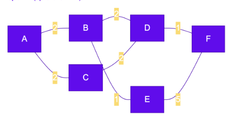

# Звіт із самостійної роботи №12

**Тема:** Порівняння протоколів маршрутизації RIP, OSPF, BGP  
**Варіант:** №4 (Джерело: **A**, Призначення: **F**)  

## Топологія мережі (Схема)

## 1. Шлях за кількістю переходів (RIP, Hop Count)

При підході RIP вага кожного ребра вважається рівною $1$. Протокол шукає шлях із найменшою кількістю роутерів (hop count).

* **Маршрут:** `A -> B -> D -> F` (або альтернативний `A -> C -> D -> F`)
* **Кількість переходів (Hops):** **3 переходи** ($A \rightarrow B \rightarrow D \rightarrow F$)

## 2. Шлях за сумою ваг (OSPF, Алгоритм Дейкстри)

Для розрахунку за вагами каналів використаємо алгоритм Дейкстри від вузла **A**.

### Таблиця кроків алгоритму Дейкстри

| Крок | Оброблюваний вузол | Відстань до A | B | C | D | E | F |
| --- | --- | --- | --- | --- | --- | --- | --- |
| **0** | Початковий стан | 0 | $\infty$ | $\infty$ | $\infty$ | $\infty$ | $\infty$ |
| **1** | **A** | 0 | **2 (A)** | **2 (A)** | $\infty$ | $\infty$ | $\infty$ |
| **2** | **B** | 2 | 2 (A) | 2 (A) | **4 (B)** | **3 (B)** | $\infty$ |
| **3** | **C** | 2 | 2 (A) | 2 (A) | 4 (B) | 3 (B) | $\infty$ |
| **4** | **E** | 3 | 2 (A) | 2 (A) | 4 (B) | 3 (B) | **8 (E)** |
| **5** | **D** | 4 | 2 (A) | 2 (A) | 4 (B) | 3 (B) | **5 (D)** |
| **6** | **F** | 5 | 2 (A) | 2 (A) | 4 (B) | 3 (B) | **5 (D)** |

* **Результат алгоритму Дейкстри:**
* **Найкоротший шлях за вагою:** `A -> B -> D -> F`
* **Підсумкова вартість (Cost):** $2 + 2 + 1 = \mathbf{5}$

## 3. Порівняльний аналіз отриманих шляхів

У Варіанті 4 шлях за кількістю переходів (`A-B-D-F`, 3 хопи) та шлях за сумою ваг (`A-B-D-F`, вартість 5) **повністю збігаються**. Таке явище виникає тоді, коли топологія мережі сформована так, що траєкторія з найменшою кількістю проміжних вузлів одночасно складається з високошвидкісних каналів із низькою вагою. Альтернативний шлях через вузол $E$ ($A \rightarrow B \rightarrow E \rightarrow F$) хоч і має таку ж кількість переходів (3 хопи), але має суттєво більшу вартість через повільний канал $E-F$ із вагою 5 ($2 + 1 + 5 = 8$).

## 4. Порівняльна таблиця RIP, OSPF, BGP та аналіз BGP

### Порівняльна таблиця протоколів

| Характеристика | RIP | OSPF | BGP |
| --- | --- | --- | --- |
| **Тип алгоритму** | Дистанційно-векторний (Distance-Vector) | Стану каналів (Link-State, Дейкстра) | Вектор шляху (Path-Vector) |
| **Метрика** | Кількість переходів (Hop count, макс. 15) | Вартість каналу (Cost = 100 Mbps / Bandwidth) | Політики, довжина AS-Path, атрибути |
| **Область застосування** | Малі локальні мережі (LAN) | Внутрішньокорпоративні мережі (IGP) | Міжпровайдерська маршрутизація (EGP) |
| **Швидкість збіжності** | Повільна (30 сек. таймери) | Дуже висока (секунди/мілісекунди) | Повільна/поміркована (навмисно затримана) |
| **Масштабованість** | Дуже низька | Висока (у межах однієї AS) | Глобальна (весь Інтернет) |

### Чому міжавтономна маршрутизація вимагає окремого протоколу BGP

Міжавтономна маршрутизація в інтернеті принципово не може використовувати внутрішні протоколи (RIP чи OSPF) з двох ключових причин. По-перше, це **масштаб глобальної таблиці маршрутизації**: глобальна мережа містить понад мільйон префіксів, і жоден OSPF не зможе розсилати стан усіх лінків світу чи рахувати для них алгоритм Дейкстри без перевантаження пам'яті та процесорів роутерів. По-друге, це **політики та договірні відносини між провайдерами (peering, transit)**: у глобальному інтернеті трафік спрямовується не за «найкоротшим технічним шляхом», а згідно з комерційними угодами провайдерів (який канал дешевший чи вигідніший за договором).

## Контрольні запитання

1. **Чому RIP і OSPF можуть обрати різні маршрути:**
RIP бачить тільки кількість роутерів на шляху (хопи) і може обрати шлях через 1 повільний кабель замість 3 швидких. OSPF враховує пропускну здатність (вагу) каналів, тому обирає найшвидший маршрут, навіть якщо він проходить через більшу кількість роутерів.
2. **Опис одного кроку алгоритму Дейкстри:**
Ми вибираємо серед ще не оброблених вузлів той, до якого наразі знайдено найкоротшу відстань. Потім дивимося на всіх його сусідів і оновлюємо значення відстаней до них, якщо шлях через наш поточний вузол виявився коротшим за попередньо відомий.
3. **Відмінність області застосування OSPF від BGP:**
OSPF використовується **всередині** однієї автономної системи (однієї компанії чи провайдера) для швидкого пошуку технічно найоптимальніших шляхів. BGP використовується **між** різними автономними системами (між провайдерами та країнами) для обміну маршрутами на основі бізнес-політик.
4. **Чому вибір маршруту в BGP не зводиться лише до найкоротшої відстані:**
Тому що в інтернеті вирішальну роль відіграють фінансові та юридичні домовленості провайдерів. Маршрутизатор BGP часто обирає шлях, який є дешевшим для компанії (наприклад, безкоштовний пиринг замість платного транзиту), навіть якщо цей шлях фізично довший.
