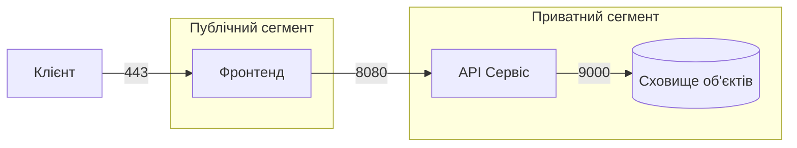

# Звіт із самостійної роботи №15

**Тема:** Хмарні та контейнерні мережі, моніторинг  
**Варіант:** №4 (Файлове сховище)  
**Вимога до ізоляції:** Сховище об'єктів доступне лише від API (без прямого доступу ззовні).

## 1. Мережева схема застосунку

* **Клієнт $\rightarrow$ Фронтенд:** порт `443/HTTPS` (Публічний сегмент).
* **Фронтенд $\rightarrow$ API:** порт `8080/HTTP` (Приватний сегмент).
* **API $\rightarrow$ Сховище:** порт `9000/S3 API` (Приватний сегмент).

## 2. Режим мережі та виявлення сервісів

Обрано режим **user-defined bridge** (або **overlay** у K8s), оскільки він створює ізольовану віртуальну підмережу та підтримує автоматичний вбудований DNS-сервер. Це дозволяє API звертатися до сховища за іменем контейнера (`http://storage:9000`), а не за IP. Режим `host` не обрано, бо він вимикає ізоляцію та публікує порти сховища назовні, що порушує безпеку. Режим `default bridge` відкинуто через відсутність автоматичного DNS-резолву.

## 3. Таблиця груп безпеки (Security Groups)

| Сервіс | Дозволений вхідний порт | Дозволене джерело | Пояснення |
| --- | --- | --- | --- |
| **Фронтенд** | `443/TCP`, `80/TCP` | `0.0.0.0/0` | Публічний доступ до веб-інтерфейсу. |
| **API Сервіс** | `8080/TCP` | `Frontend` (`10.0.1.0/24`) | Доступний лише з публічного сегмента. |
| **Сховище об'єктів** | `9000/TCP` | **Лише `API**` | Повна ізоляція від зовнішньої мережі. |

## 4. Метрики та порядок діагностики

### Перелік метрик:

1. **Затримка (Response Latency):** час обробки S3-запитів на завантаження/скачування.
2. **Частка помилок (Error Rate):** відсоток відповідей HTTP 5xx та 4xx.
3. **Healthcheck:** перевірка стану контейнерів через `/healthz`.
4. **Ресурси (Resource Usage):** CPU, RAM та вільний диск сховища.

### Порядок діагностики (3 кроки):

1. **Крок 1 (Статус і DNS):** перевірити статус контейнерів (`docker ps`) та доступність порту з API до сховища (`nc -zv storage 9000`).
2. **Крок 2 (Метрики та мережа):** перевірити Grafana на ріст 5xx помилок і правила Security Group/Network Policy.
3. **Крок 3 (Логи та ресурси):** вивчити `docker logs storage` та перевірити диск і пам'ять (на випадок OOMKilled).

## Контрольні запитання

1. **Чому базі чи черзі не варто відкривати порт назовні:**
Щоб зменшити поверхню атаки та унеможливити прямой підбір паролів чи DDoS-атаки з інтернету.
2. **Який режим підходить без ізоляції і чому це рідко виправдано:**
Режим `host`. Він небезпечний, бо позбавляє контейнери мережевої ізоляції та створює конфлікти портів на сервері.
3. **Перша перевірка при «сервіс недоступний»:**
Перевірити, чи запущений контейнер, та виконати ping/curl до його мережевого порту.